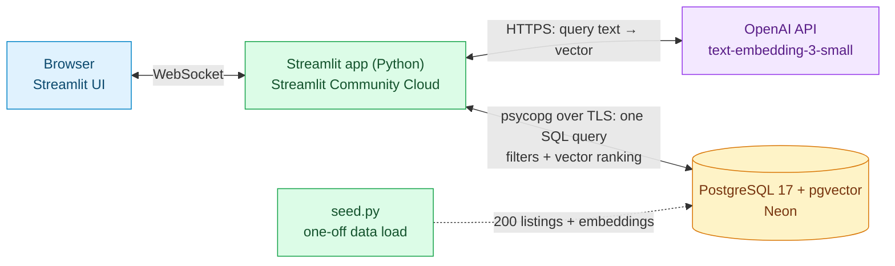

# Berlin Flat Finder

Describe the flat you want in plain language ("quiet 2-room flat near a park, good for working from home"),
set a few filters (max price, min rooms, district), and get the best-matching Berlin listings.

Built in **about 4 hours** at **AI Builders × commIT Hack Day Berlin** (20 November 2026), with some final
adjustments afterwards.

**Live demo:** https://berlin-flat-finder-ghsaidi.streamlit.app
(free hosting: if the app has been idle, click the wake-up button and wait about 30 seconds)

## How it works
- **PostgreSQL 17 + pgvector** stores the listings and their embeddings, and does the filtering and similarity search.
- **OpenAI `text-embedding-3-small`** turns listings and queries into vectors.
- **Streamlit** provides the UI.
- The data is ~200 **synthetic** listings generated by a script (no scraping).

A search embeds the query text once (cached), then runs **one SQL query**: `WHERE` applies the filters and
`ORDER BY embedding <=> query` ranks the remaining listings by cosine distance. The match % is the cosine
similarity; queries unrelated to flats (top match below 30 %) get a hint with example queries instead of results.

## Architecture

- The browser only renders the UI. The Python backend talks to PostgreSQL directly over its native protocol
  (psycopg, TLS), so API keys and the database never reach the client.
- Listing embeddings are computed once at seed time and stored in the database; each search embeds only the
  query text (cached for repeated queries).
- Filtering, similarity ranking and the result limit all happen inside PostgreSQL.

## Status
- [x] Project setup
- [x] M1: semantic + filter search
  - [x] Schema (`listings` with `vector(1536)` + HNSW index), synthetic data generator, embedding + seeding
  - [x] Search query + Streamlit UI
  - [x] Deployed: Streamlit Community Cloud + Neon (hosted PostgreSQL with pgvector)
- [ ] M2: districts, stats, hybrid (full-text + vector) ranking
- [ ] M3: AI-written recommendation (RAG) + search log

## Run locally
Requires Docker, [uv](https://docs.astral.sh/uv/) and an OpenAI API key.
```
cp .env.example .env
docker compose up -d
scripts/migrate.sh
uv sync
uv run python generate_data.py
uv run python seed.py
uv run streamlit run app.py
```
The default database credentials (`postgres`/`postgres`, overridable with `POSTGRES_USER` and `POSTGRES_PASSWORD`)
are for local development only; the database port is bound to `127.0.0.1`, and the deployed app uses a hosted
database with its own credentials. Add your `OPENAI_API_KEY` to `.env` before seeding. `generate_data.py` is deterministic (fixed seed);
`seed.py` embeds all 200 listings in one API call.

## Development workflow
Three small Bash scripts in `scripts/` wrap the database steps so they are repeatable:

| Script | What it does | How it was used |
|---|---|---|
| `scripts/migrate.sh` | Applies every SQL file in `sql/` in order to the local Docker database. Each file is idempotent, so re-running is safe. | Creates the schema from `sql/001_m1.sql` (pgvector extension, `listings` table, HNSW index). |
| `scripts/checkpoint.sh <tag>` | Saves a full database dump to `snapshots/<tag>.sql` after a finished, working task, then prints the git commands for committing, tagging and pushing (it does not run them). | Created `snapshots/m1.sql` for the `m1` tag. The same dump was later loaded into the hosted Neon database for deployment. |
| `scripts/restore.sh <tag>` | Replaces the local `flats` database with a snapshot. Used together with resetting the code to the matching git tag. | Safety net for reverting a broken task; it was not needed during the hackathon. |

Work happens on the `dev` branch; `main` only receives finished checkpoints (fast-forward merges), so every tag
pairs working code with a matching database snapshot.

The repository also contains Claude Code guardrails in `.claude/`: permission rules and hook scripts that block
risky commands and protect secrets. See [CLAUDE.md](CLAUDE.md).

## Deploy
1. Create a hosted PostgreSQL database with pgvector (e.g. Neon) and load the data:
   `psql "<DATABASE_URL>" < snapshots/m1.sql` (any `psql` client works, e.g. the one in the Docker container).
2. On Streamlit Community Cloud, deploy `app.py` from `main` with Python 3.12.
3. Add the secrets in TOML format: `OPENAI_API_KEY`, `OPENAI_EMBEDDING_MODEL` and `DATABASE_URL`
   (with `?sslmode=require`). Streamlit exposes root-level secrets as environment variables, so no code changes are needed.

## Known limitations
This is a 4-hour hackathon prototype. Its current weak spots:
- **Cold starts on free hosting.** Streamlit Community Cloud puts the app to sleep after 12 hours without visitors.
  The next visitor has to click a wake-up button and wait about 30–60 seconds. Neon's free database also pauses
  after about 5 minutes without queries, so the first search after a break is slower.
- **Streamlit is a prototyping tool.** Every interaction reruns the whole script, page loads feel slow, and layout,
  styling and mobile design options are limited.
- **Not built for many users.** All visitors share one database connection (no connection pool), there is no rate
  limiting, and every new search text costs an OpenAI API call. Heavy traffic would be slow and could run up costs.
- **Small, synthetic data.** 200 generated listings with template-based descriptions: no real market data, no
  images, no map, no availability or freshness.
- **Simple search.** Vector similarity plus three filters. No keyword or hybrid ranking yet, and filters written in
  the text ("under €1,200 in Pankow") are not turned into real filters. The 30 % relevance threshold was tuned by
  hand on a few queries.
- **The match % is raw cosine similarity.** Good matches score 50–80 %, which can look low even when the ranking is right.
- **No automated tests or CI.** Data is loaded into the hosted database by hand from a SQL dump.

## Roadmap
**In this codebase**
- **M2:** a `districts` table with JOINs and a stats view; hybrid ranking that combines PostgreSQL full-text search with vector similarity.
- **M3:** an OpenAI model writes a short recommendation from the retrieved listings (RAG); every search is logged in the database.
- A softer hint for vague queries: show results together with a "be more specific" tip.

**Towards a product** (planned as a new version built on this one)
- **Real data, collected legally.** Replace the synthetic listings with open data (for example Berlin's open data
  portal, and OpenStreetMap for parks, transport and amenities), official partner APIs or feeds, and scraping only
  where a site's terms and robots.txt allow it, with rate limits and GDPR-compliant handling of personal data.
  Scheduled ingestion with deduplication and freshness tracking.
- **A proper frontend.** Next.js/React (TypeScript) with a map view, listing pages and mobile-first design, talking
  to a separate Python API (for example FastAPI) instead of Streamlit.
- **A data layer for large volumes.** From 200 rows to millions: batch embedding pipelines, connection pooling, tuned
  pgvector indexes and partitioning, and a separate analytics store for market statistics if PostgreSQL alone no longer fits.
- **Richer AI.** RAG recommendations that cite the listings they use, conversational search that refines results
  over several turns, an LLM that turns free text into structured filters, re-ranking, and an evaluation set to
  measure search quality.
- **Production basics.** Always-on hosting (no sleep), rate limiting and cost caps, monitoring, user accounts with
  saved searches and alerts, automated tests and CI.

## License
See [LICENSE](LICENSE).
